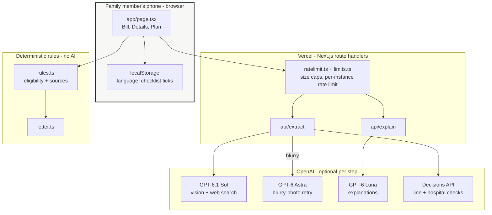
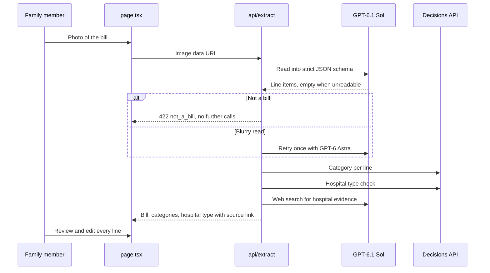
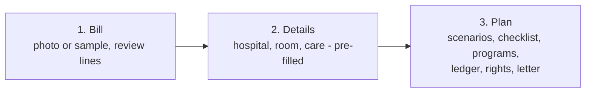
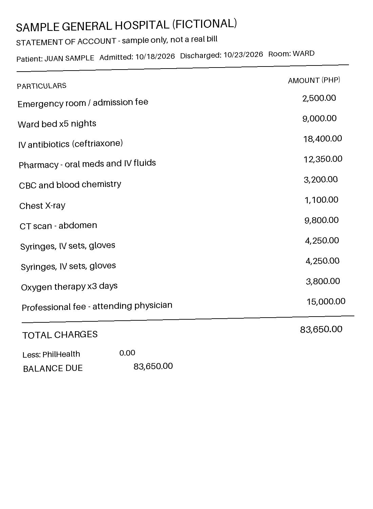

# Akop

<p align="center">
  
</p>

<p align="center">
  
  
  
  
</p>

<p align="center">
  
  
  
  
  
  
  
</p>

<p align="center">
  
  
  
</p>

> **Your hospital bill, explained** — turn a photo of a Philippine Statement of Account into a plan the family can act on at the billing window.

**Live app:** https://akop.vercel.app

**Jump to:** [Problem](#problem) · [Solution](#solution) · [System architecture](#system-architecture) · [Feature set](#current-feature-set) · [Demo flow](#demo-flow) · [Tech stack](#tech-stack) · [Project map](#project-map) · [Run locally](#run-locally) · [Limitations](#limitations) · [Visual identity](#visual-identity-and-assets)

Akop is a mobile-first web app that reads a photo of a hospital bill and returns a personal plan: each charge explained in English or Taglish, which aid programs may apply, what the family may still owe, which offices to visit with which documents, and a ready-to-print request letter. Built for the Codex × UX+AI Hackathon, 25 October 2026.

## Team

**Group Name:** _add team name_

| Member | Role |
| --- | --- |
| Ethan Dreiz Baltazar | Full Stack + Project Manager |
| _add member_ | _add role_ |

## Problem

Households paid ₱615.16B out of pocket for health in 2024, 42.7% of current health expenditure (PSA, Philippine National Health Accounts). The person handling the bill is usually a family member standing at the billing window, on a phone, with a document full of unfamiliar charge names.

In 2026 the rules changed: ward stays at DOH hospitals can be zero-balance and politicians no longer distribute medical aid. Private rooms, private hospitals and outpatient care are still not covered, and families cannot tell which side of the line they are on.

## Solution

Akop splits the job in two. AI does the reading and the explaining. Plain TypeScript rules do the deciding, so eligibility is never a model guess and every rule can be traced to a source.

> **AI reads and explains. Code decides.**

- **Read the bill.** Photo in, line items out, with unreadable amounts left empty instead of guessed.
- **Explain every charge** in plain English or Taglish, one sentence per line.
- **Decide with cited rules.** Zero balance billing, PhilHealth, senior/PWD discounts, MAIFIP, DSWD AICS, PCSO and Malasakit, each with source, date checked and what is still unverified.
- **Hand over an action plan.** Balance scenarios, an ordered checklist of offices and documents, and a request letter.

## How It Works

1. **Read.** GPT-6.1 Sol reads the bill photo into line items through the Responses API with a strict JSON schema; unreadable amounts come back empty, never guessed. A blurry read retries once with GPT-6 Astra.
2. **Check.** The OpenAI Decisions API (GPT-6 Luna) gives a second opinion on each line's category. The hospital type is decided automatically and double-checked: Decisions API plus a GPT-6.1 Sol web search that returns evidence and a source link.
3. **Explain.** GPT-6 Luna writes one plain sentence per line in English and Taglish.
4. **Decide.** Plain TypeScript rules (no AI) work out zero balance billing, PhilHealth, senior/PWD discounts, MAIFIP, DSWD AICS, PCSO and Malasakit, the balance scenarios, the ordered checklist and the letter. Every rule cites its source, date checked and what is still unverified.

## System Architecture



### Bill extraction pipeline



### Screen flow



## Current Feature Set

### Bill Reading

- Camera capture (`capture="environment"`) or photo upload, plus a fictional sample bill.
- Strict-schema extraction; unreadable amounts stay empty.
- One automatic retry on a blurry read.
- Non-bill photos are rejected with 422 before any paid follow-up call.
- Every line is editable: change an amount, add or remove a line. The printed total is kept, and a mismatch notice shows when lines do not add up.

### Explanations

- One plain sentence per charge in **English** or **Taglish**, switchable in place.
- Language choice is remembered on the device.

### Eligibility Rules

- Zero balance billing, PhilHealth, senior/PWD discounts, MAIFIP, DSWD AICS, PCSO and Malasakit.
- Hospital type is pre-filled by Decisions API plus a web search with a source link, and shows "Please check" when unverified.
- Every rule carries its source, date checked and open questions. Core file: `navigator/lib/rules.ts`.

### The Plan

- Balance scenarios (for example ₱0 at a DOH ward versus a private-room balance).
- Ordered checklist of offices and documents; ticks are saved to `localStorage`.
- Programs that may apply, a charge ledger, patient rights, and limitations.
- Printable request letter with the family's names filled in and the printed bill total quoted.

### Safety and Privacy

- No accounts and no server storage.
- API key lives only in server environment variables.
- Route handlers validate input, cap sizes and rate limit per IP (`navigator/lib/ratelimit.ts`, `limits.ts`).

## Demo Flow

1. Open https://akop.vercel.app.
2. Tap the sample bill, or photograph a real one.
3. Review the 12 extracted lines; edit one amount and watch the total update.
4. Continue to Details; check the pre-filled hospital, room and care.
5. Change the hospital to DOH and see the ₱0 zero-balance scenario appear.
6. Toggle English and Taglish.
7. Open the plan: scenarios, checklist, programs, ledger, rights.
8. Fill the names and print the request letter.

## Tech Stack

| Layer | Technology |
| --- | --- |
| Frontend | Next.js 16, React 19, Tailwind CSS 4 |
| Vision and web search | GPT-6.1 Sol through the OpenAI Responses API |
| Blurry-photo retry | GPT-6 Astra |
| Line and hospital checks | OpenAI Decisions API (GPT-6 Luna) |
| Explanations | GPT-6 Luna, English and Taglish |
| Eligibility and letter | Plain TypeScript rules, no AI |
| Validation | Zod strict schemas |
| Local state | `localStorage` (language, checklist) |
| Testing | Vitest (26 rules tests) |
| Deployment | Vercel, project root `navigator/` |

## Project Map

```text
navigator/                Next.js app (deployed from here)
  app/
    page.tsx              three-step flow: bill, details, plan
    api/extract/          photo -> bill (vision, Decisions API, hospital check)
    api/explain/          line explanations in English and Taglish
  lib/
    rules.ts              deterministic eligibility rules with sources
    hospital.ts           two-way hospital type check
    decide.ts             Decisions API line categories
    detect.ts             bill / not-a-bill detection
    extract-utils.ts      extraction helpers
    letter.ts             request letter builder
    limits.ts             input size caps
    ratelimit.ts          per-IP rate limiting
    sample.ts             fictional sample bill
    types.ts              shared types
  public/sample-soa.jpg   fictional sample bill photo
  tests/rules.test.ts     rules unit tests
docs/
  PRD.docx                product requirements
  QA-REPORT.md            QA results and bugs fixed
  ux/                     design spec, UX research, prototype, logo
  research/               program-rules research prompt
videos/akop-demo/         demo video source
```

## Run Locally

```bash
cd navigator
npm install
echo "OPENAI_API_KEY=sk-..." > .env.local
npm run dev
```

Open http://localhost:3000.

## Production Build

```bash
npm run build
npm start
```

## Testing

```bash
npm test
```

Runs Vitest over `navigator/tests/rules.test.ts`: 26 tests, all passing on the QA build. See [`docs/QA-REPORT.md`](docs/QA-REPORT.md) for the backend and frontend checks (360, 375 and 1280 px), bugs found and fixed, and what was not tested.

## Environment Variables

All server-only:

```text
OPENAI_API_KEY=

# Optional model overrides
EXTRACT_MODEL=
ESCALATE_MODEL=
EXPLAIN_MODEL=
DECIDE_MODEL=
VERIFY_MODEL=
```

Do not commit `.env.local`. Vercel deploys from `navigator/` on every push to `main`.

## Limitations

- Program rules come from agency notices, news and agency pages. The full text of DOH DO 2026-0443 (zero balance billing) and AO 2026-0031 (MAIFIP) has not been read yet. All results are estimates.
- Not confirmed: income and non-member rules for zero balance billing, outpatient coverage, PCSO payment of doctors' fees, and the PhilHealth refund route.
- AI can misread small or blurry amounts; the user reviews every line.
- Rate-limit counters are per server instance.
- Not tested: a real phone camera, iPhone HEIC and rotated photos, printing on paper, screen reader pass.
- No accounts and no server storage. The sample bill is fictional.

## Judging Highlights

- **Impact:** built for families facing out-of-pocket hospital bills in the Philippines.
- **Trustworthy AI:** AI reads and explains; cited TypeScript rules decide. Unreadable amounts are left empty, never guessed.
- **Second opinions:** Decisions API checks each line category and the hospital type, backed by a web search with a source link.
- **Honest uncertainty:** every rule shows its source, date checked and what is unverified.
- **Bilingual:** English and Taglish explanations and plan.
- **Action-ready:** ordered office and document checklist plus a printable letter.
- **Private by default:** no accounts, no server storage.

## Visual Identity and Assets

<p align="center">
  
  
  
</p>

| Asset | File | Used for |
| --- | --- | --- |
| Logo (raster) | `docs/ux/akop-logo.png` | README, branding |
| Logo (vector) | `docs/ux/akop-logo.svg` | Branding |
| Sample bill | `navigator/public/sample-soa.jpg` | Fictional Statement of Account for demos |
| Prototype | `docs/ux/prototype.html` | Early interaction prototype |
| Design spec | `docs/ux/DESIGN.md` | Tokens, components, accessibility |
| UX research | `docs/ux/RESEARCH.md` | Research behind the flow |

### Design language

- **Palette (light):** `#F7F8F6` canvas, `#FFFFFF` surface, `#172321` ink, `#075E57` primary, `#754A00` notice, `#A52A24` danger. A dark theme is specified in `docs/ux/DESIGN.md`.
- **Style:** calm, high-contrast, phone-first, large tap targets.
- **Tagline:** *Your hospital bill, explained.*

## References and Citations

- [PSA Philippine National Health Accounts](https://psa.gov.ph/) - out-of-pocket health spending figures.
- [PhilHealth](https://www.philhealth.gov.ph/) - national health insurance benefits.
- [DOH](https://doh.gov.ph/) - zero balance billing and MAIFIP issuances.
- [DSWD AICS](https://www.dswd.gov.ph/) - Assistance to Individuals in Crisis Situations.
- [PCSO](https://www.pcso.gov.ph/) - medical assistance programs.
- [Next.js Documentation](https://nextjs.org/docs) - app framework.
- [OpenAI API Documentation](https://platform.openai.com/docs) - Responses API and Decisions API.
- [Vercel Deployments Documentation](https://vercel.com/docs/deployments) - hosting.

## Credits

Built for the Codex × UX+AI Hackathon, 25 October 2026.

*Akop* means to embrace or take under one's care in Filipino. The app is meant to do that for the family at the billing window.
