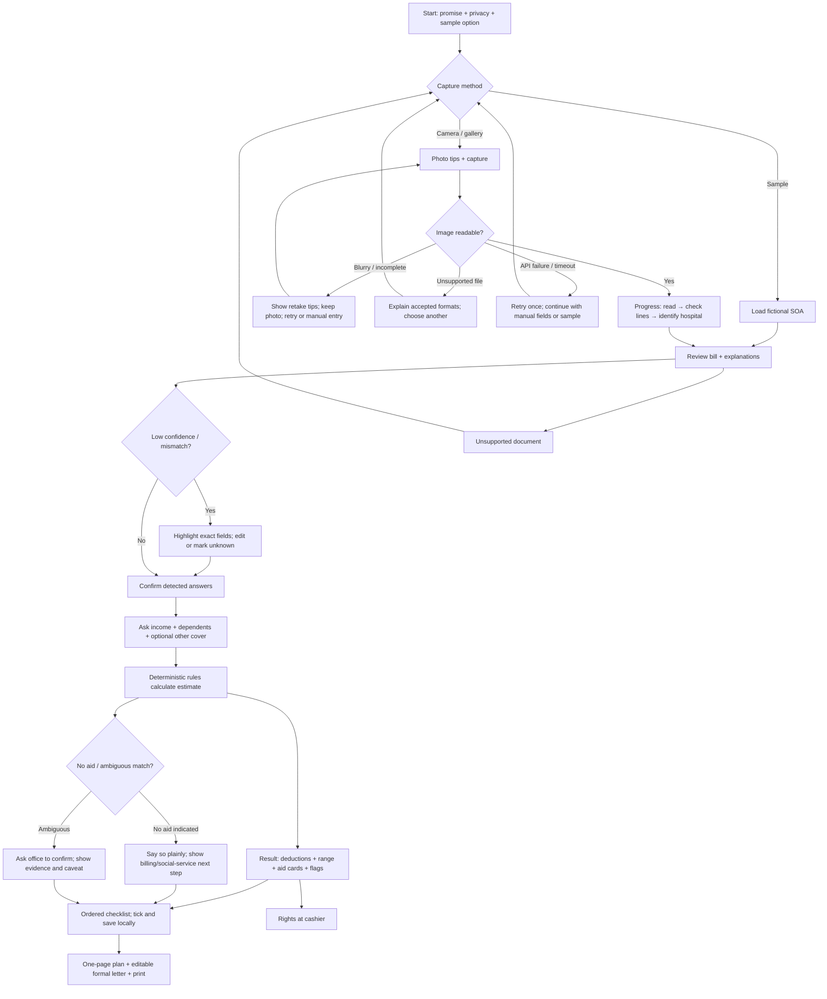

# BayadGabay UX design

**Audience:** a family member at a hospital billing window, often using a phone while stressed. **Primary viewport:** 375 × 812 CSS px; must work from 360px up. **Task target:** get to a useful first action in under five minutes. **Date:** 25 October 2026.

## Product decisions

- One guided flow with a persistent “where am I?” step indicator. No chatbot, account, or dashboard.
- The photo is the starting point; extracted information is an editable draft. Ask the user for only household income, dependents, and optional other coverage after bill facts are prefilled.
- Show a balance as a range, and separate amounts already printed/deducted from potential future support. Avoid implying programs stack or are guaranteed.
- Explain each line item and flag a discrepancy as “Please ask about this,” never “fraud” or “wrong charge.”
- Keep rules and AI visibly distinct: AI reads/explains; the coded rules produce program indications. Sources/caveats are available at the point of the result.
- Rejected: map-first browsing (adds a location decision before the user knows which office); full-page policy exposition (poor at a counter); chat (hard to audit, slower, and risks invented eligibility advice); single exact payoff number (false precision).

## 1. Information architecture and flow



## 2. Screen-by-screen specification

All screens use a centered desktop column (max 760px) with a persistent page header. On desktop, capture/review may use a 40/60 split with image preview on the left and editable fields on the right. On 375px mobile, stack everything, keep actions full-width, and use a fixed bottom primary action only when it does not obscure content.

| Screen | Layout and components | English copy | Taglish copy | States and behavior |
|---|---|---|---|---|
| 0. Start | Brand, concise promise, 3-step preview, camera primary, choose-photo secondary, sample link, privacy line and estimate note. | “Understand this hospital bill. Find your next step.” / “Your photo is used to read the bill. We don’t keep it.” | “Intindihin ang hospital bill. Alamin ang susunod na hakbang.” / “Gagamitin ang photo para basahin ang bill. Hindi namin ito ise-save.” | Empty; privacy details open inline; offline/sample is available. |
| 1. Capture | Camera/gallery buttons, framing guide illustration, quick photo tips, accepted formats. Keep sample visible. | “Take a clear photo of the full Statement of Account (SOA).” | “Kunan ng malinaw na photo ang buong Statement of Account (SOA o billing statement).” | Camera permission denied → offer gallery; unsupported type → explain JPEG/PNG/WEBP; upload busy → disable duplicate actions. |
| 2. Reading | Progress stepper with concrete steps, status text, no fake percent. | “Reading the bill… Checking amounts… Looking for hospital details…” | “Binabasa ang bill… Tinitingnan ang amounts… Hinahanap ang detalye ng ospital…” | Loading; timeout shows “This is taking longer than expected” and Retry/Manual/sample; preserve selected file in memory. |
| 3. Review bill | Hospital name/type summary; editable line cards; amount; plain English/Taglish explanation; total check; alerts above affected line. Source image can be collapsed/opened. | “Check what we read. Tap a highlighted amount to fix it.” | “Tingnan ang nabasa namin. I-tap ang naka-highlight na amount para itama.” | Empty extraction → manual add line or try another image; low-confidence amount → “Couldn’t read—enter it or leave unknown”; totals mismatch → show difference, never auto-correct total. |
| 4. Confirm details | Check-answer list. Detected value appears with “From your bill” and confidence/evidence; Change opens a single-choice sheet. Unknowns shown distinctly. | “We filled in a few details. Please check them.” | “May ilang detalye kaming nilagay mula sa bill. Pakisuri.” | Detection conflict → “Please double-check” and both evidence/source; allow “I’m not sure.” |
| 5. Household | One question per short card, buttons for income ranges; dependents stepper; optional “other cover already approved/quoted” amount. | “Which income range best fits your household?” “How many people depend on this income?” | “Aling income range ang pinakamalapit sa household ninyo?” “Ilang tao ang umaasa sa income na ito?” | Explain why asked. Unknown allowed if rules can produce an ambiguous result. Never require exact income. |
| 6. Result | Persistent estimate header; waterfall; program cards sorted by likely action; issue flags; clear confirmation CTA. | “Your estimated balance after known deductions” | “Tantyang balanse matapos ang mga kaltas na alam na” | Success; no aid indicated → no dead end; ambiguous → ask office; low confidence → badge and direct link to review; show disclaimer in viewport. |
| 7. Action plan | Numbered office cards, action verb, what to bring and where to get it, coverage/expected purpose, checkbox. | “Start with billing. Then take this list to social service.” | “Unahin ang billing. Pagkatapos, dalhin ang listahang ito sa social service.” | Progress stored only in localStorage; storage blocked → temporary in-memory state and explain; conditional docs visually labeled. |
| 8. Letter and print packet | Letter form with patient/requester/relationship/contact inputs; formal English output; print plan, list, letter, rights. | “Prepare a request letter” / “Print this plan” | “Ihanda ang request letter” / “I-print ang planong ito” | Blank optional fields allowed; print preview hides controls, includes date, estimate note, sources; browser print/save PDF. |

## 3. Critical screen details

### A. Bill capture

Mobile order: top back/header → title and short instruction → camera primary (min 56px height) → gallery secondary → “Use fictional sample bill” text button → 3 short camera tips → privacy note. Add a simple four-corner framing illustration and “Keep the total and all lines in frame.” The camera input uses `accept="image/*" capture="environment"`; gallery remains distinct. Do not promise perfect OCR. Offer manual fallback in the same error panel.

```text
┌──────────────────────────────┐
│ BayadGabay        1 of 4     │
│ Start with a photo           │
│ [ Take a photo        56px ] │
│ [ Choose from phone   52px ] │
│ Use fictional sample bill    │
│                              │
│ Lay flat · good light         │
│ Keep total in frame           │
│ Photo is not saved.           │
└──────────────────────────────┘
```

### B. Bill explanation and flags

Each line is a card with the original bill wording preserved. Amount and category remain editable. The explanation sits under the line in a lighter surface. A yellow flag says “Ask billing to explain this line” plus a short reason. “Possible duplicate” and arithmetic mismatch are described as checks, not conclusions. Use an explicit total block: “Bill says ₱… / Lines add to ₱… / Difference ₱…”. Never overwrite the stated total. Low-confidence values accept “I’ll check this with billing” and remain excluded/uncertain in calculation until confirmed.

### C. Result summary

Show the range first, not a single large “savings” number. Example (fictional):

```text
ESTIMATE · confirm with hospital billing
Possible balance after confirmed deductions
₱18,400 – ₱42,700

Bill total                         ₱56,200
Already shown as deducted         −₱8,000
Senior/PWD covered items          −₱1,200  estimated
Possible additional assistance    varies  not guaranteed
```

Display arithmetic inputs and bounds; explain any potential additional aid separately. If the existing rules engine uses a policy cap to bound the range, label the cap as a scenario, not an award. Never imply multiple agencies will pay cumulatively. Program card: name + likelihood (“Likely”, “Ask to confirm”, “Not indicated”), one-sentence why, next action, “Why this result” disclosure with the answers used, source title/link, checked date, and caveat. If no program is indicated, state “No program matched these answers. This does not prove you cannot get help. Ask hospital social service to review your case.”

### D. Checklist

Number steps by recommended first visit, not an official universal sequence. Each includes office, counter-ready sentence, document checklist, where to obtain missing papers, whether step is conditional, and what assistance it relates to. Add “This order is a practical suggestion; offices may direct you differently.” Store tick state in localStorage; make it work without storage. Checklist is print-friendly and uses actual checkbox semantics.

### E. Letter and one-page plan

One page packet: fictional/privacy-safe header; estimate caveat; relevant program indications and their sources; ordered checklist; suspicious bill questions; rights card; then editable formal English letter. Leave patient and representative identifiers blank unless user enters them. Never include medical diagnosis from the SOA in sample content. Letter text asks for assessment and a written itemized balance; it does not assert entitlement or threaten legal action.

### F. Rights at the cashier

Use a distinct “If you cannot pay now” card with exact cautious summary: RA 9439 generally bars detention solely for inability to pay, but the law has stated exceptions, including private-room patients. Never imply the right applies to every case. Suggested script: “Please explain the unpaid balance and any release options. Can I speak with the hospital social worker? Please give me the itemized bill and any document I need to sign.” Link the [law text](https://lawphil.net/statutes/repacts/ra1997/ra_9439_1997.html) and advise asking a qualified office for the person’s situation. The existing rules code has a detention note; the wording must be reviewed against the cited statute before shipping.

## 4. Trust and uncertainty system

- **Persistent label:** “Estimate only · The hospital/agency makes the final decision.” Show on result, print, and letter packet.
- **Three evidence levels:** `Read from bill` (user can correct), `Likely match` (rules conditions match but office confirmation remains), `Needs confirmation` (ambiguous or rule caveat). Avoid numeric confidence percentages unless calibrated and user-tested.
- **Source disclosure:** Every program card has “Why this result” and lists trigger answers, official source when available, `Checked [date]`, and a short unresolved question. Unverified rules explicitly say “Rule details not confirmed against full current order.”
- **Money provenance:** Every amount has a label: printed bill amount, user-confirmed amount, calculated estimate, or possible aid. Provide the formula and use range endpoints. No unsupported “you save” or “you qualify.”
- **OCR provenance:** Keep original description and extracted value visible; mark uncertain field with icon + text, not color alone. User correction has immediate effect on the estimate.
- **Failure honesty:** If the source lookup/API fails, say what could not be checked. Never silently present cached data as current. Show sample mode as fictional.

## 5. Visual design system

Warm paper background, deep ink, calm teal for primary actions, amber for “check this,” and restrained red for blocking errors. A rounded geometric sans (system stack) keeps it robust offline. No decorative gradients, glass effects, or medical stock-photo hero.

| Token | Light | Dark | Use |
|---|---|---|---|
| `canvas` | `#F7F8F6` | `#111918` | App background |
| `surface` | `#FFFFFF` | `#1B2523` | Cards and controls |
| `ink` | `#172321` | `#F2F6F4` | Main text |
| `muted` | `#465652` | `#C1CFCA` | Secondary text; ensure measured contrast |
| `primary` | `#075E57` | `#68D3C4` | Main action/link; on-color `#FFFFFF` light, `#102421` dark |
| `border` | `#AAB8B3` | `#53615D` | Dividers and fields |
| `notice` | `#754A00` | `#FFD27A` | Caution text/icon; background `#FFF3D6` / `#392B10` |
| `danger` | `#A52A24` | `#FF9B91` | Errors; background `#FFF0EE` / `#3D201E` |

Target all normal text at ≥4.5:1, large text at ≥3:1, UI boundaries/focus at ≥3:1 against neighbors. Validate actual token pairs before handoff. Body 16–18px, helper 14px minimum, numeric balance 32–40px, H1 30–34px, H2 24px, line-height 1.45–1.6. Spacing grid 4px, common steps 8/12/16/24/32. Radius 12px controls, 16px cards, pill only for short status labels. Elevation: one subtle shadow layer at most. Use familiar line icons with accessible labels; emoji are not the only meaning. Buttons 48–56px high. Progress shows named steps; use reduced-motion-aware 150ms fades only, no looping shimmer, and honor `prefers-reduced-motion`.

## 6. Accessibility, inclusion, performance

- WCAG 2.2 AA target: semantic headings/landmarks, labels and fieldset/legend, keyboard operation, visible focus, logical focus after validation, error summary + inline error, status announcements, text alternatives, no color-only status, reflow at 320px/200% zoom, text spacing overrides, contrast, reduced motion, and 24px AA minimum targets (design uses ≥44px comfort targets).
- English/Taglish toggle is persistent and uses `aria-pressed`; maintain equivalent meaning and never translate official program names into confusing variants. Keep letter in formal English.
- Large text uses flexible height, wraps, no fixed-height cards; support browser zoom and OS text scaling.
- Low bandwidth: compress image client-side, cap dimensions, no external font or image dependency, no background polling, no analytics containing bill data, cached fictional sample, graceful retry/manual path.
- Privacy: no account, no server persistence, avoid logging request bodies, explain upload immediately before capture. Real data not retained locally after leaving the tab; checklist state contains only generic task ticks.
- Print stylesheet: white background, black ink, URLs/source names visible, cards avoid splitting, hide buttons and navigation, page numbers/date, one-page action summary when possible and letter on following page. Letter fields remain editable before print.

## 7. 60–90 second demo storyline

**0–10s:** “A family at the cashier has a bill but no clear idea what is already covered or where to ask next.” Show start and privacy statement.

**10–25s:** Tap fictional sample bill; show reading progress, editable hospital/room detections, and one low-confidence item. Explain AI reads; it does not decide aid.

**25–40s:** Open one line explanation and one flagged discrepancy. Show English → Taglish toggle. Emphasize the original bill wording stays visible.

**40–58s:** Answer only income/dependents. Reveal the bill-to-deductions waterfall, remaining balance range, and one “Likely” plus one “Ask to confirm” card with source/caveat.

**58–75s:** Show ordered billing → social service → agency checklist and tick one item. Explain progress stays on this device.

**75–90s:** Open printable letter/plan and cashier-rights card. Close: “It turns a confusing bill into a careful, sourced next step—without pretending an estimate is approval.”

## Prioritized implementation plan (no app changes made)

1. **P0 — Capture, errors, progress:** revise `navigator/app/page.tsx` start/capture/loading states; keep existing `/api/extract` and `/api/explain` contracts untouched. Review `navigator/app/api/extract/route.ts` only for UI contract mapping; do not change endpoint behavior without separate approval.
2. **P0 — Extracted bill review:** improve editable line cards, total reconciliation, confidence presentation, and manual unknown state in `navigator/app/page.tsx`; verify data shape against `navigator/lib/types.ts`. Do not modify deterministic rules in `navigator/lib/rules.ts` as part of this UX plan.
3. **P0 — Result transparency:** improve estimate header, waterfall labels, program-card disclosures, no-match/ambiguous states in `navigator/app/page.tsx`; keep `navigator/lib/decide.ts` restricted to AI classification/explanation, never eligibility.
4. **P0 — Source freshness:** create an owner-reviewed source registry/UI mapping around existing `ProgramResult` source, `lastVerified`, and `caveat` fields in `navigator/lib/types.ts`; rule review itself is separate policy work. Do not present unverified rules as confirmed.
5. **P1 — Action plan and print packet:** improve checklist, local-only progress, letter, and rights card in `navigator/app/page.tsx`; refine print rules in `navigator/app/globals.css`; preserve browser-storage failure behavior.
6. **P1 — Design tokens and responsive/accessibility pass:** centralize tokens and component styles in `navigator/app/globals.css`; audit layout/tap targets/focus/error semantics in `navigator/app/page.tsx` and shared components if extracted.
7. **P2 — Accessibility content/QA:** define copy keys for `en`/`tl` near UI components or in a future `navigator/lib/copy.ts`; document accessibility checks and approved Taglish translations. Add checks only as a separate implementation request.
8. **P2 — Data-rule verification:** policy owner reviews sources and exact ZBB/MAIFIP/AICS/PCSO criteria before edits to `navigator/lib/rules.ts`; keep that file unchanged during the current design task.

## Open questions

1. Can the team read and verify the controlling 2026 ZBB and MAIFIP orders before any UI says “Likely”?
2. Which hospital/region should the fictional demo represent, and which office names are locally recognizable?
3. Is a partially unreadable bill calculation allowed to continue with an explicitly incomplete range, or should the user first resolve the uncertain total?
4. Should the rights card be hidden unless an inpatient ward setting is confirmed, given the private-room statutory exception?
5. What formal Taglish style should the project use: conversational Filipino-English or mostly Filipino with English agency terms?
